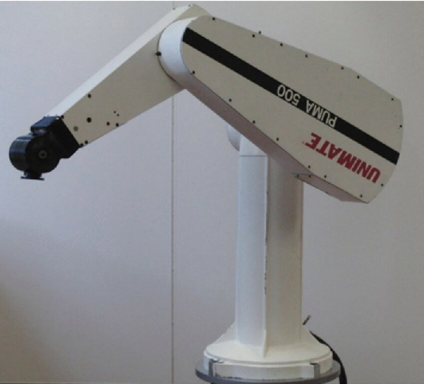
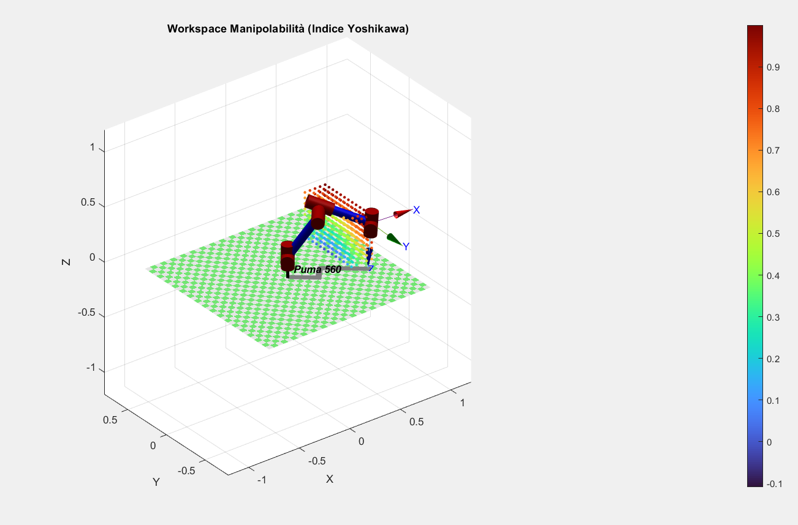
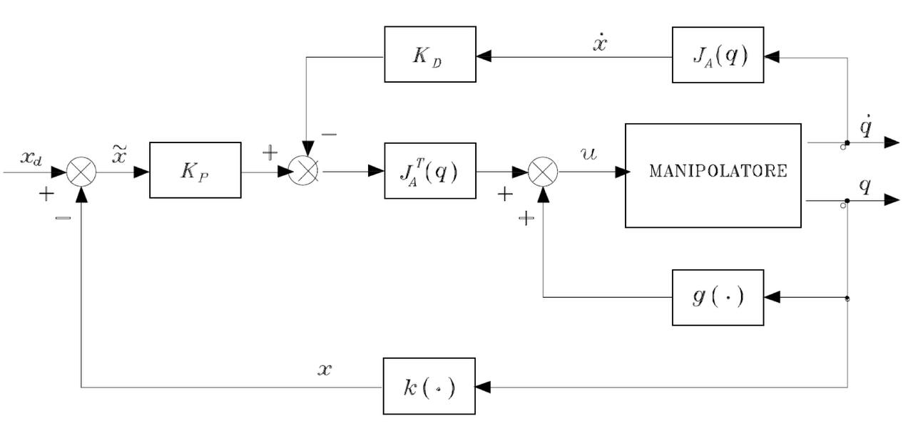
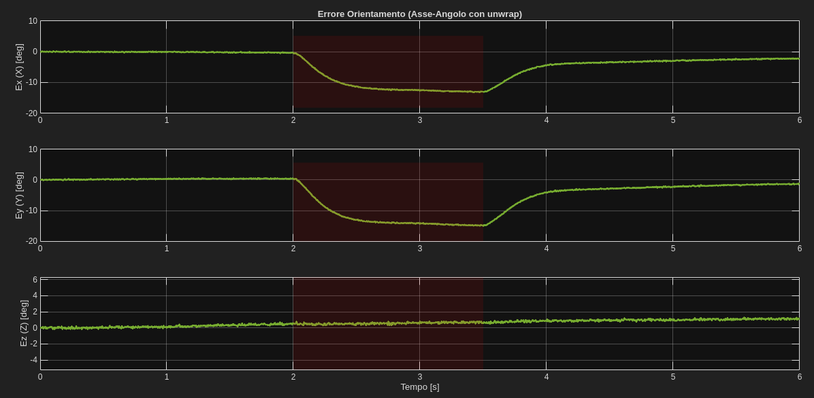
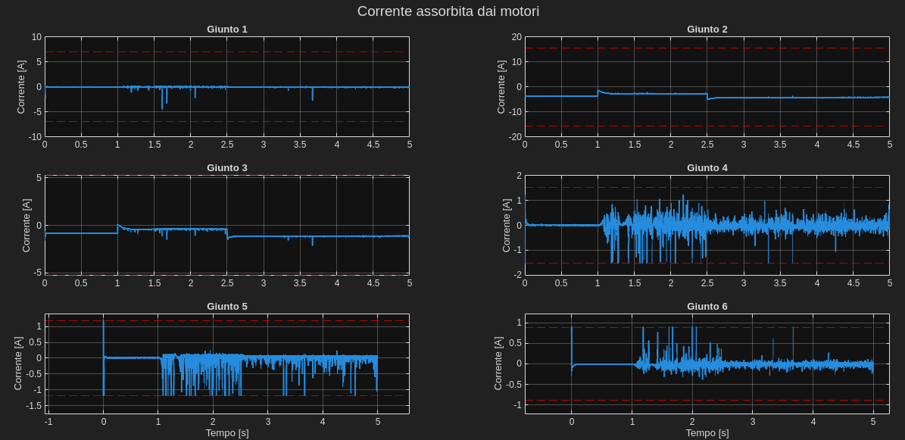

# PD Control with Gravity Compensation in Operational Space — PUMA 560

Design and simulation-based validation (MATLAB + Peter Corke Robotics Toolbox) of an **operational-space PD controller with gravity compensation** for the **PUMA 560** manipulator, carrying a payload at the end-effector and subject to an external disturbance.

> Course project for *Robotics mod. I – Industrial handling*
> M.Sc. in Automation Engineering — Politecnico di Bari, A.Y. 2025-2026
> **Authors:** Angelo Gregucci, Leonardo Li Bergolis — **Supervisor:** Prof. Ing. Paolo Lino
>
> 📄 Full report (Italian): [`docs/Robotics_I_project_Gregucci_Li_Begolis.pdf`](docs/Robotics_I_project_Gregucci_Li_Begolis.pdf)

---

## Goal

Hold the PUMA 560 end-effector at a desired pose while it carries the **maximum payload (2.5 kg)** and is hit by an **external disturbance of −90 N along z**, verifying that:

- the controller counteracts the disturbance and brings the robot back to the desired pose once it ends;
- joint torques respect the actuators' saturation limits;
- the **motor currents** stay within the real physical limits.

Two approaches to orientation representation were compared:

1. **Analytical Jacobian + ZYZ Euler angles**
2. **Geometric Jacobian + axis-angle representation** ✅ (adopted solution)

## The manipulator: PUMA 560

<p align="center">
  
  
</p>

A 6-DoF anthropomorphic serial manipulator (3 positioning joints + spherical wrist), maximum payload 2.5 kg. It is a well-established benchmark in the robotics literature (including NASA-supported studies, e.g. NASA-CR-192756), with accurate kinematic and dynamic models available in the Robotics Toolbox.

## 1. Reachability analysis — Yoshikawa manipulability index

The operating pose is chosen by sweeping a grid of the workspace
(x ∈ [0.4, 0.6], y ∈ [−0.3, 0.3], z ∈ [−0.1, 0.3], step 0.05 m) with orientation `trotx(pi)`.
For each point, inverse kinematics is solved (`ikine6s`) and the Yoshikawa manipulability index
w = √det(J Jᵀ) is computed (`maniplty`); the point with the highest w becomes the desired pose (function `bestPoint`).

<p align="center"></p>

## 2. Control law

<p align="center"></p>

$$
u = g(q) + J^\top \left( K_p\,\tilde{x} - K_d\,J\,\dot{q} \right), \qquad \tilde{x} = x_d - x
$$

The output is saturated using the PUMA 560 maximum joint torques (from NASA-CR-192756):

τ_limit = [97.6, 186.4, 89.4, 24.2, 20.1, 21.3] Nm

### Operational-space PD tuning

Starting from the apparent inertia in operational space

$$
\Lambda(q) = \left(J M^{-1}(q) J^\top\right)^{-1}
$$

the gains impose second-order dynamics (mass-spring-damper behaviour at the end-effector):

$$
K_p = \Lambda\,\omega_n^2, \qquad K_d = 2\,\zeta\,\Lambda\,\omega_n \qquad (\omega_n = 8\ \text{rad/s},\ \zeta = 0.9)
$$

The gains are recomputed at every step from the current configuration.

## 3. Sensor model

To make joint measurements realistic, the transducer delay is modelled as a **first-order filter** (τ = 160 µs, discretized with backward differences) with added **measurement noise**.

<p align="center"></p>

## 4. Orientation representation

### ZYZ Euler angles + analytical Jacobian ❌

$J_A = T_A^{-1}(\phi)\,J$, with $\omega = T(\phi)\,\dot\phi$ and $\det T(\phi) = -\sin\theta$:
the matrix is singular for θ = 0, π (**representation singularity**). The optimal pose lies close to this condition
(confirmed by `jacob0(q,'eul')`), leading to a non-zero steady-state error and impulsive spikes in the motor currents, despite regularization.

### Axis-angle + geometric Jacobian ✅

$$
R_{err} = R_d R_c^\top,\quad
\theta = \arccos\frac{\mathrm{tr}(R_{err})-1}{2},\quad
e_o = \frac{\theta}{2\sin\theta}
\begin{bmatrix} R_{32}-R_{23} \\ R_{13}-R_{31} \\ R_{21}-R_{12} \end{bmatrix}
$$

The geometric Jacobian maps joint velocities directly to (v, ω), without going through T(φ): no algorithmic singularity and better numerical stability.

<p align="center">
  
  
</p>

## 5. Motor current analysis

Motor currents are derived from joint torques as $I = \tau / (K_t N)$, with $K_t = 0.223$ Nm/A and gear ratios
N = [62.6, 53.7, 76.7, 71.9, 76.0, 107.3]. Limits: I_max = [6.99, 15.55, 5.23, 1.51, 1.18, 0.89] A.

| ZYZ Euler + analytical J | Axis-angle + geometric J |
|:---:|:---:|
|  |  |
| impulsive currents, reaching the limits | smooth profile, well within the limits |

## Conclusions

PD control with gravity compensation based on the **geometric Jacobian and axis-angle representation** stabilizes the load at the desired pose, is robust to the disturbance, and keeps motor currents within physical and safety limits.

**Future work:** quaternion-based orientation · computed-torque / adaptive control · Runge-Kutta integration · more realistic actuator modelling (friction, delays, thermal limits) · experimental validation.

---

## Repository structure

```
.
├── docs/
│   ├── Robotics_I_project_Gregucci_Li_Begolis.pdf   # full report (Italian)
│   └── img/                                         # report figures
└── Progetto_robotics_1/Progetto/
    ├── main_asse_angolo.m   # simulation: geometric J + axis-angle (final solution)
    ├── main_ZYZ.m           # simulation: analytical J + ZYZ Euler (comparison)
    ├── main_ZYZ.mat         # saved data from the ZYZ simulation
    ├── startup_rvc.m        # toolbox initialization
    ├── robot/ spatial-math/ common/ vision/ contrib/   # Peter Corke Robotics Toolbox (RVC)
    └── ...
```

Main functions (defined at the bottom of the two `main_*.m` scripts):

| Function | Description |
|---|---|
| `bestPoint` | optimal pose search via Yoshikawa index + workspace plot |
| `pd_gravity_gains` | Kp, Kd tuning from operational-space inertia |
| `pd_gravity_controller` | PD + g(q) control law with torque saturation |
| `trasduttore_giunti` | sensor model (first-order filter + noise) |
| `jacobanalitic` | analytical Jacobian for ZYZ angles (`main_ZYZ.m` only) |

## How to run

Requirements: MATLAB (toolbox targets R2017b+). The Robotics Toolbox is already bundled in the folder.

```matlab
cd Progetto_robotics_1/Progetto
main_asse_angolo   % or main_ZYZ
```

The scripts run `startup_rvc` and `mdl_puma560` automatically, then launch the simulation
(Euler integration, disturbance applied for 1.5 s) and produce plots of position error, orientation error and motor currents.

## References

1. D. C. Swift, *Command Generator Tracker Based Direct Model Reference Adaptive Control of a PUMA 560 Manipulator*, CIRSSE Report #124, NASA-CR-192756, Rensselaer Polytechnic Institute, 1992. [ntrs.nasa.gov/citations/19930012117](https://ntrs.nasa.gov/citations/19930012117)
2. D. Jokić et al., *Two Open Solutions for Industrial Robot Control: The Case of PUMA 560*, Electronics 9, 972, 2020. [doi:10.3390/electronics9060972](https://doi.org/10.3390/electronics9060972)
3. P. Corke, *Robotics, Vision and Control* — [Robotics Toolbox for MATLAB](https://github.com/petercorke/robotics-toolbox-matlab)

## License

Third-party code in the `robot/`, `spatial-math/`, `common/`, `vision/` and `contrib/` folders belongs to Peter Corke and the respective authors and is distributed under their original licenses.
