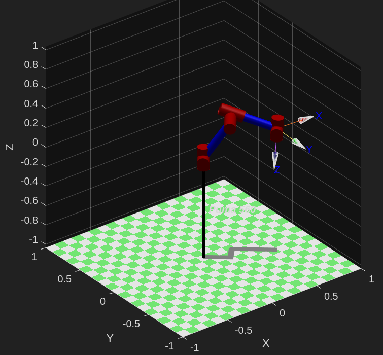
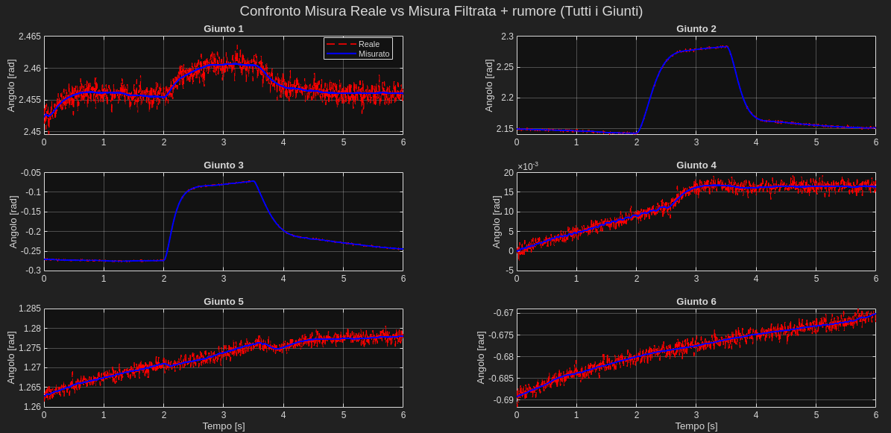
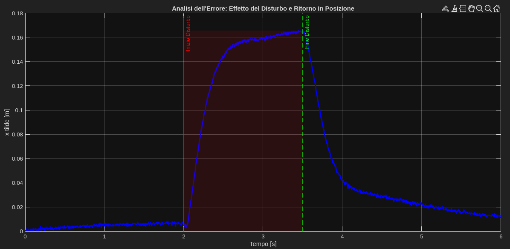
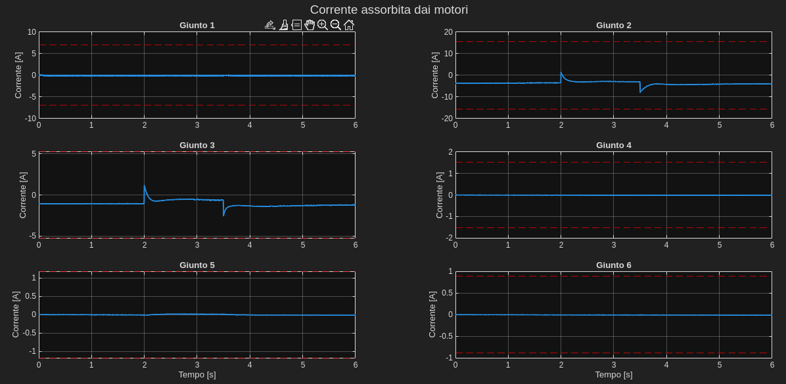

# PD Control with Gravity Compensation in Operational Space — PUMA 560

Progettazione e validazione in simulazione (MATLAB + Peter Corke Robotics Toolbox) di un **controllore PD con compensazione di gravità nello spazio operativo** per il manipolatore **PUMA 560**, con payload all'end-effector e disturbo esterno.

> Tesina del corso *Robotics mod. I – Industrial handling*
> Laurea Magistrale in Ingegneria dell'Automazione — Politecnico di Bari, A.A. 2025-2026
> **Autori:** Angelo Gregucci, Leonardo Li Bergolis — **Docente:** Prof. Ing. Paolo Lino
>
> 📄 Report completo: [`docs/Robotics_I_project_Gregucci_Li_Begolis.pdf`](docs/Robotics_I_project_Gregucci_Li_Begolis.pdf)

---

## Obiettivo

Mantenere l'end-effector del PUMA 560 in una posa desiderata mentre sostiene il **payload massimo (2.5 kg)** e subisce un **disturbo esterno di −90 N lungo z**, verificando che:

- il controllore si opponga al disturbo e riporti il robot nella posa desiderata al termine di esso;
- le coppie rispettino i limiti di saturazione degli attuatori;
- le **correnti assorbite dai motori** restino entro i limiti fisici reali.

Sono stati confrontati due approcci per la rappresentazione dell'orientamento:

1. **Jacobiano analitico + angoli di Eulero ZYZ**
2. **Jacobiano geometrico + rappresentazione asse-angolo** ✅ (soluzione adottata)

## Il manipolatore: PUMA 560

<p align="center">
  
  
</p>

Manipolatore seriale antropomorfo a 6 DoF (3 giunti di posizionamento + polso sferico), payload massimo 2.5 kg. È un benchmark consolidato in letteratura (anche in studi NASA, es. NASA-CR-192756) con modelli cinematici e dinamici accurati disponibili nel Robotics Toolbox.

## 1. Analisi di raggiungibilità — Indice di Yoshikawa

La posa operativa è scelta esplorando una griglia dello spazio di lavoro
(x ∈ [0.4, 0.6], y ∈ [−0.3, 0.3], z ∈ [−0.1, 0.3], passo 0.05 m) con orientamento `trotx(pi)`.
Per ogni punto si risolve la cinematica inversa (`ikine6s`) e si calcola l'indice di manipolabilità di Yoshikawa
w = √det(J Jᵀ) (`maniplty`); il punto con w massimo diventa la posa desiderata (funzione `bestPoint`).

<p align="center"></p>

## 2. Legge di controllo

<p align="center"></p>

$$
u = g(q) + J^\top \left( K_p\,\tilde{x} - K_d\,J\,\dot{q} \right), \qquad \tilde{x} = x_d - x
$$

L'uscita è saturata con le coppie massime del PUMA 560 (da NASA-CR-192756):

τ_limit = [97.6, 186.4, 89.4, 24.2, 20.1, 21.3] Nm

### Tuning PD nello spazio operativo

A partire dall'inerzia apparente nello spazio operativo

$$
\Lambda(q) = \left(J M^{-1}(q) J^\top\right)^{-1}
$$

i guadagni impongono una dinamica del secondo ordine (comportamento massa-molla-smorzatore all'end-effector):

$$
K_p = \Lambda\,\omega_n^2, \qquad K_d = 2\,\zeta\,\Lambda\,\omega_n \qquad (\omega_n = 8\ \text{rad/s},\ \zeta = 0.9)
$$

I guadagni sono ricalcolati ad ogni passo in funzione della configurazione corrente.

## 3. Modello del trasduttore

Per rendere realistica la misura dei giunti, il ritardo del trasduttore è modellato con un **filtro del primo ordine** (τ = 160 µs, discretizzato con differenze all'indietro) con aggiunta di **rumore di misura**.

<p align="center"></p>

## 4. Rappresentazione dell'orientamento

### Euler ZYZ + Jacobiano analitico ❌

$J_A = T_A^{-1}(\phi)\,J$, con $\omega = T(\phi)\,\dot\phi$ e $\det T(\phi) = -\sin\theta$:
la matrice è singolare per θ = 0, π (**singolarità di rappresentazione**). La posa ottima ricade vicino a questa condizione
(confermato da `jacob0(q,'eul')`), causando errore a regime non nullo e picchi impulsivi nelle correnti, nonostante la regolarizzazione.

### Asse-angolo + Jacobiano geometrico ✅

$$
R_{err} = R_d R_c^\top,\quad
\theta = \arccos\frac{\mathrm{tr}(R_{err})-1}{2},\quad
e_o = \frac{\theta}{2\sin\theta}
\begin{bmatrix} R_{32}-R_{23} \\ R_{13}-R_{31} \\ R_{21}-R_{12} \end{bmatrix}
$$

Il Jacobiano geometrico mappa direttamente le velocità di giunto in (v, ω), senza passare per T(φ): nessuna singolarità algoritmica e maggiore stabilità numerica.

<p align="center">
  
  
</p>

## 5. Analisi delle correnti

Correnti motore ricavate dalle coppie ai giunti con $I = \tau / (K_t N)$, con $K_t = 0.223$ Nm/A e rapporti di trasmissione
N = [62.6, 53.7, 76.7, 71.9, 76.0, 107.3]. Limiti: I_max = [6.99, 15.55, 5.23, 1.51, 1.18, 0.89] A.

| Euler ZYZ + J analitico | Asse-angolo + J geometrico |
|:---:|:---:|
|  |  |
| correnti impulsive, raggiungono i limiti | andamento regolare, ampiamente entro i limiti |

## Conclusioni

Il controllo PD con compensazione di gravità basato su **Jacobiano geometrico e rappresentazione asse-angolo** stabilizza il carico nella posa desiderata, è robusto al disturbo e mantiene le correnti dei motori entro i limiti fisici e di sicurezza.

**Sviluppi futuri:** orientamento con quaternioni · controllo computed-torque / adattativo · integrazione Runge-Kutta · modellazione più realistica degli attuatori (attriti, ritardi, limiti termici) · validazione sperimentale.

---

## Struttura del repository

```
.
├── docs/
│   ├── Robotics_I_project_Gregucci_Li_Begolis.pdf   # report completo
│   └── img/                                         # figure del report
└── Progetto_robotics_1/Progetto/
    ├── main_asse_angolo.m   # simulazione: J geometrico + asse-angolo (soluzione finale)
    ├── main_ZYZ.m           # simulazione: J analitico + Euler ZYZ (confronto)
    ├── main_ZYZ.mat         # dati salvati della simulazione ZYZ
    ├── startup_rvc.m        # inizializzazione del toolbox
    ├── robot/ spatial-math/ common/ vision/ contrib/   # Peter Corke Robotics Toolbox (RVC)
    └── ...
```

Funzioni principali (definite in fondo ai due script `main_*.m`):

| Funzione | Descrizione |
|---|---|
| `bestPoint` | ricerca della posa ottima tramite indice di Yoshikawa + plot del workspace |
| `pd_gravity_gains` | tuning di Kp, Kd dall'inerzia nello spazio operativo |
| `pd_gravity_controller` | legge di controllo PD + g(q) con saturazione delle coppie |
| `trasduttore_giunti` | modello del sensore (filtro del 1° ordine + rumore) |
| `jacobanalitic` | Jacobiano analitico per angoli ZYZ (solo `main_ZYZ.m`) |

## Come eseguire

Requisiti: MATLAB (testato con toolbox per R2017b+). Il Robotics Toolbox è già incluso nella cartella.

```matlab
cd Progetto_robotics_1/Progetto
main_asse_angolo   % oppure main_ZYZ
```

Gli script eseguono `startup_rvc` e `mdl_puma560` automaticamente, poi lanciano la simulazione
(integrazione di Eulero, disturbo applicato per 1.5 s) e producono i grafici di errore, orientamento e correnti.

## Riferimenti

1. D. C. Swift, *Command Generator Tracker Based Direct Model Reference Adaptive Control of a PUMA 560 Manipulator*, CIRSSE Report #124, NASA-CR-192756, Rensselaer Polytechnic Institute, 1992. [ntrs.nasa.gov/citations/19930012117](https://ntrs.nasa.gov/citations/19930012117)
2. D. Jokić et al., *Two Open Solutions for Industrial Robot Control: The Case of PUMA 560*, Electronics 9, 972, 2020. [doi:10.3390/electronics9060972](https://doi.org/10.3390/electronics9060972)
3. P. Corke, *Robotics, Vision and Control* — [Robotics Toolbox for MATLAB](https://github.com/petercorke/robotics-toolbox-matlab)

## Licenza

Il codice di terze parti nelle cartelle `robot/`, `spatial-math/`, `common/`, `vision/` e `contrib/` appartiene a Peter Corke e ai rispettivi autori ed è distribuito secondo le loro licenze originali.
